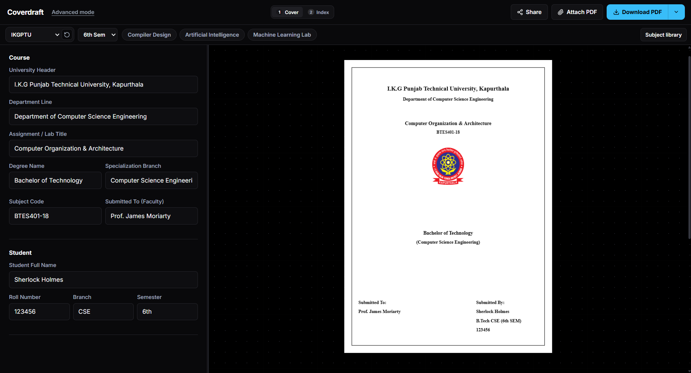
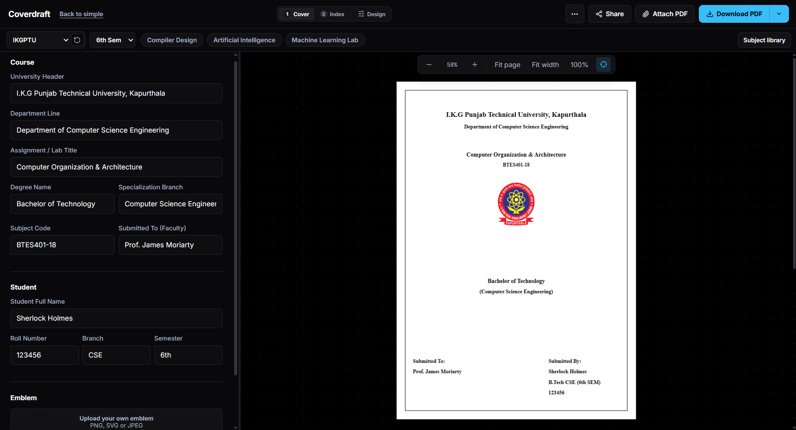
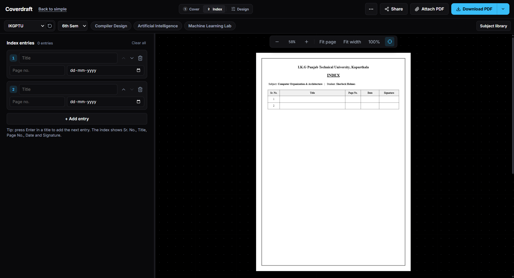
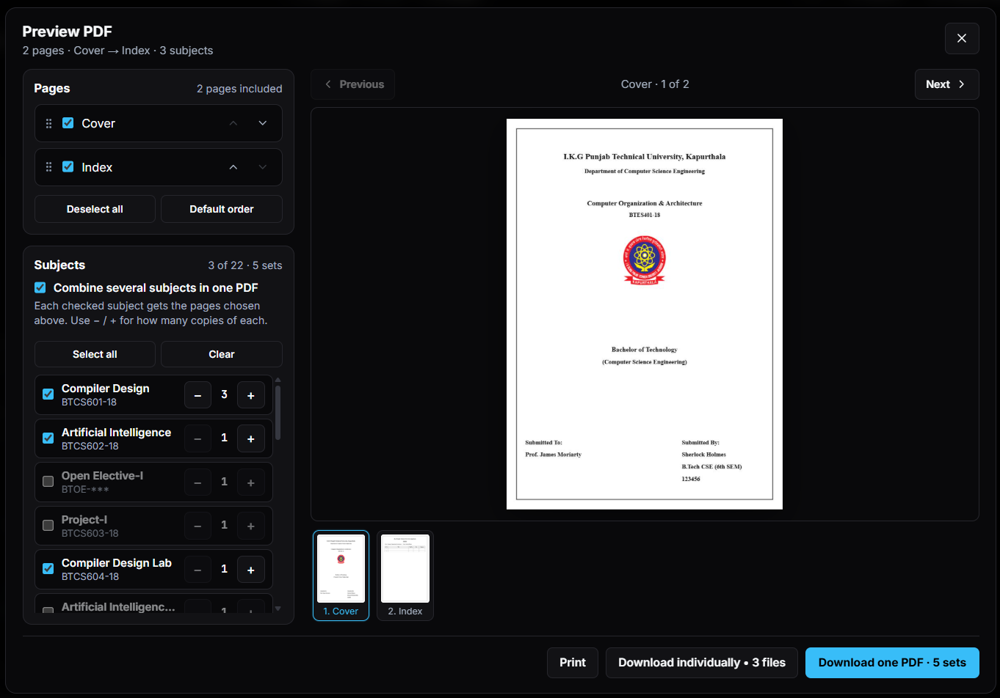
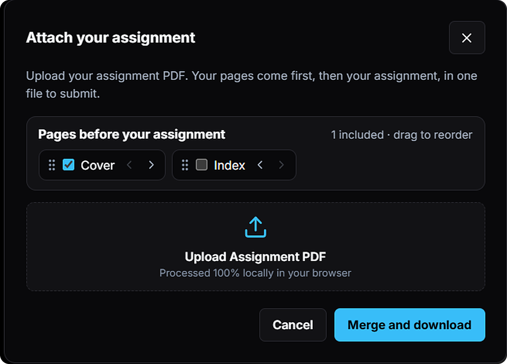
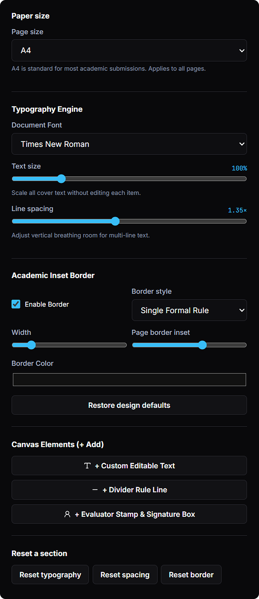
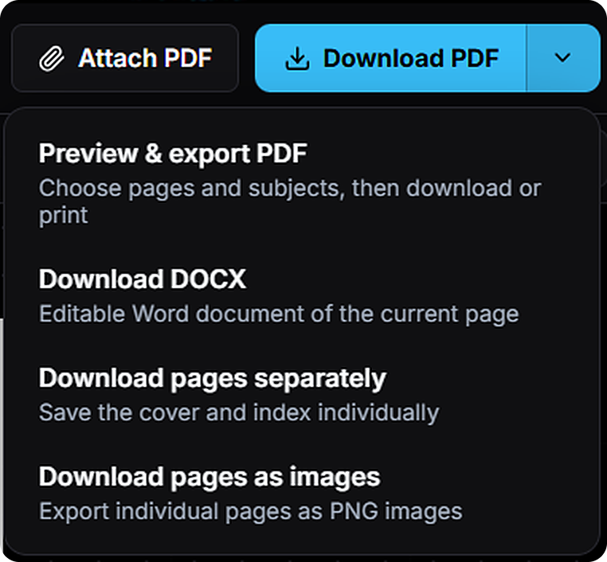
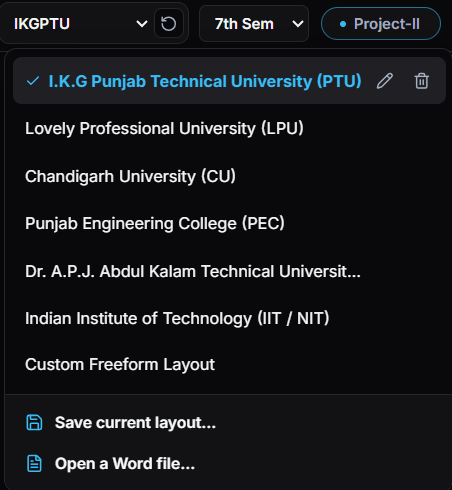
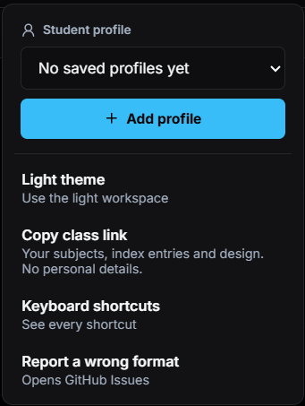

<div >

# Coverdraft

**Built a simple tool to save me 3 minutes by getting the job done in 30 seconds after spending 3 weeks building it.**

[](https://rishipx.github.io/Coverdraft/)
[](#documentation)
[](https://github.com/rishipx/Coverdraft/issues)
 
[](LICENSE)


<br>



</div>

## Features

| | |
| --- | --- |
| **Pages** | Cover and index in one document, with six built-in university templates |
| **Editing** | University, semester, paper size and subject pickers. Edit elements, borders, fonts and spacing in Simple or Advanced (canvas) mode |
| **Layouts** | Built-in templates and your saved layouts in one picker. Rename, edit, delete or restore them in place |
| **Import** | Word `.docx` to editable pages, or pull cover details and experiment rows into the form |
| **Preview PDF** | Choose and reorder pages and subjects, preview, then download. Several subjects export as one combined PDF or one PDF each |
| **Attach & merge** | Merge an existing assignment PDF behind the generated pages |
| **Export** | PDF, DOCX, PNG and print, plus batch and separate-page exports |
| **Workspace** | Local drafts, student profiles, class links, light/dark theme |
| **Everywhere** | Responsive, keyboard-accessible, installable, offline after the first load |

## Screenshots

| | |
| --- | --- |
| <br>**Advanced mode.** | <br>**Index page.** |
| <br>**Preview PDF.** | <br>**Attach PDF.** |

<table>
  <tr>
    <td width="33%" valign="top">
      <br>
      <b>Design panel.</b>
    </td>
    <td width="33%" valign="top">
      <br>
      <b>Subject library.</b><br><br>
      <br>
      <b>Download menu.</b>
    </td>
    <td width="33%" valign="top">
      <br>
      <b>University picker.</b><br><br>
      <br>
      <b>More menu.</b>
    </td>
  </tr>
</table>

## Quick start

Needs **Node.js 20+** (build, checks) and **Python 3** (local server, browser tests).

| Command | What it does |
| --- | --- |
| `npm run serve` | Local server at `http://localhost:8080` |
| `npm run build` | Regenerate `templates.generated.js` and `precache.generated.js` |
| `npm run check` | Freshness, syntax, accessibility and hygiene checks |
| `npm run test:browser` | Chromium tests. First: `pip install playwright && playwright install chromium` |
| `npm run sri` | Fill or refresh integrity hashes of the CDN libraries (needs internet) |
| `npm run icons` | Regenerate the PNG app icons |

> **Heads up:** after changing `src/templates/` or adding or removing files in `src/`, run `npm run build` and commit the generated files. CI fails when they are stale.

## Templates and layouts

**In the app**

| I want to… | Do this |
| --- | --- |
| Tweak a built-in university | Hover its name in the picker, press the pencil (or `F2`), then rename it or replace its default layout with the page on screen. **Restore built-in** undoes it. |
| Make my own layout | Start from **Custom Freeform Layout** or any university, style it in Advanced mode, then **Save current layout…** in the picker footer. |
| Use my crest | Upload your own emblem (PNG, SVG or JPEG) in the form. |
| Add subjects | **Subject library → + Add subject**. |
| Start from a Word file | **Open a Word file…** in the picker. |

- Everything above stays in your browser. Details: [Saved layouts](docs/TEMPLATES.md#saved-layouts-user-data).

**For maintainers**

- A new built-in university is a folder in `src/templates/` with `template.json`, `courses.json` and an emblem, then `npm run build`.
- See the [template guide](docs/TEMPLATES.md), or [open an issue](https://github.com/rishipx/Coverdraft/issues) to request one.

---

### Repository layout

```text
.
├── src/                    # The deployable site, published as-is
│   ├── index.html · sw.js · manifest.webmanifest
│   ├── assets/
│   │   ├── css/            # app, student-workflow, mobile
│   │   ├── icons/          # SVG and PNG app icons
│   │   └── js/
│   │       ├── config.js   # Public settings (report link)
│   │       ├── core/       # Storage, state, editor, canvas, PDF/DOCX export
│   │       ├── features/   # Menus, import, layouts, subjects, export, workspace
│   │       └── data/       # Generated template registry, CDN library list
│   └── templates/<id>/     # template.json, courses.json, images/emblem.*
├── scripts/                # Build, checks, icon and SRI tools
├── tests/                  # Playwright browser tests
├── docs/                   # Guides and screenshots
└── .github/                # CI workflow, issue and PR templates
```
---
### Privacy

- Drafts, saved layouts and opened files stay on your device and are never uploaded.
- The only network requests are for the PDF/Word libraries and fonts from public CDNs. Details in [SECURITY.md](SECURITY.md).

### Disclaimer

Coverdraft is an independent project. **It is not affiliated with, endorsed by, or sponsored by any university or institution** named in it. Full text in [DISCLAIMER.md](DISCLAIMER.md).

### Documentation

[Architecture](docs/ARCHITECTURE.md) · [Templates](docs/TEMPLATES.md) · [Deployment](docs/DEPLOYMENT.md) · [Accessibility](docs/ACCESSIBILITY.md)

[Contributing](CONTRIBUTING.md) · [Security](SECURITY.md) · [Disclaimer](DISCLAIMER.md)

---

### License

[MIT License](LICENSE). Bundled [Lucide](https://lucide.dev) icons are ISC.